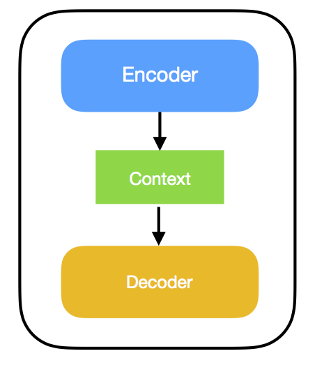
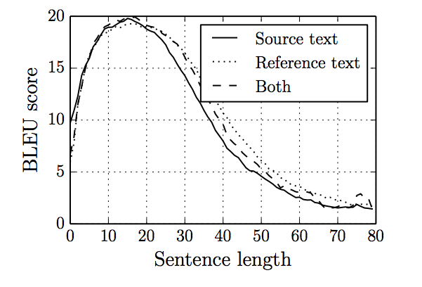
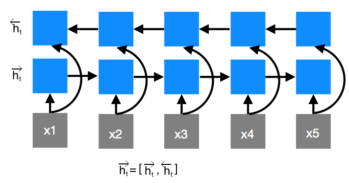
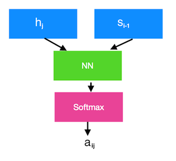
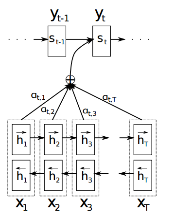

***ဒီ post မှာ စာဖတ်သူဟာ Recurrent Neural Network(RNN) တွေအကြောင်းသိပြီးသားလို့ ယူဆပါတယ်။ မသိသေးရင် ဒီ [video](https://youtu.be/Keqep_PKrY8) လေးကိုအရင်ကြည့်ပါ။*** 

**Contents**
* Traditional Statistical Machine Translation
* Neural Machine Translation
* Sequence to Sequence Model
* Sequence to Sequence Model ရဲ့ပြသနာ
* Attention Mechanism  
* Model
{:toc}

# Traditional Statistical Machine Translation
---
Machine Translation ဆိုတာ ကိုယ့်မှာရှိတဲ့ ဘာသာစကားတစ်ခု (Source Language)နဲ့ ရေးထားတဲ့စာကို တခြားကိုယ်လိုချင်တဲ့ ဘာသာစကားတစ်ခု (Target Language) ကိုဘာသာပြန်ပေးတဲ့ နည်းပညာပါ။
သမရိုးကျ Statistical Machine Translation ကရှုပ်ထွေးပါတယ်။ 
အဲဒီ သမရိုးကျစနစ်တွေမှာ တည်ဆောက်ပုံတွေ အမျိုးမျိုးရှိတတ်ပေမဲ့ အခြေခံသဘောတရားကတော့ တူပါတယ်။   

ပထမဦးဆုံး Source Language နဲ့ရေးထားတဲ့ Corpus (စာကြောင်း data)ရယ်၊ သူနဲ့သက်ဆိုင်တဲ့ ဘာသာပြန်ထားတဲ့ Target Language Cropus ရှိရပါမယ်။ အဲဒါကို Parallel Corpus လို့လည်းခေါ်ပါတယ်။

ပြီးတော့ ပြန်ချင်တဲ့ စာကြောင်းကို အစိတ်အပိုင်းတွေခွဲရမယ်။ တချို့က word level ခွဲတယ်။ တချို့က phrase level ခွဲတယ်။ ခွဲပြီးရင် Target Language က အစိတ်အပိုင်းတွေနဲ့ တိုက်ကြည့်ပေးရမယ် (Align လုပ်ရမယ်)။ ပြီးရင် အဲကမှတဆင့် Statistics တွေတွက်ချက်ပြီး Learn လုပ်မယ်။ ဘာသာပြန်တာလုပ်မယ်။ ပြီးရင် ပြန်လို့ရတဲ့စာသားကို Grammar မှန်မှန်ဖြစ်အောင် Language Model သုံးပြီးပြန်စီမယ်။

အဲဒီအဆင့်တွေအကုန်လုံးက ရှုပ်ထွေး၊ ခက်ခဲပါတယ်။ ပြီးတော့ သေချာ ရွေးချယ်ထားတဲ့ (hand-engineered) features တွေလဲလိုတယ်။ 

# Neural Machine Translation
---
နောက်ပိုင်းမှာ Traditional MT ကအခက်အခဲတွေကို Neural Networks သုံးပြီးဖြေရှင်းဖို့ ကြိုးစားလာကြတယ်။ 
Neural Machine Translation မှာက Model တစ်ခုထဲကပဲ သူ့ဘာသာ ဘယ်လို ဘာသာပြန်ရမလဲဆိုတာ သင်ယူသွားတာပါ။ အဲဒီအတွက် သမရိုးကျ Statistical Machine Translation System တွေလို လူကနေ feature engineerလုပ်စရာတွေမလိုဘူး။ Segmentation တွေ Phrase Alignလုပ်ဖို့ ရှုပ်ရှုပ်ထွေးထွေးအဆင့်တွေ ရေးပေးစရာမလိုဘူး။ သူ့ဟာသူ ဘယ်လို feature တွေက အရေးပါတယ်၊ Align ဘယ်လိုလုပ်မယ်ဆိုတာကို သင်ယူသွားလိမ့်မယ်။

Neural Machine Translation Model အများစုက Encoder-Decoder သဘောတရားကို အခြေခံတယ်။
ကိုယ်ဘာသာပြန်ချင်တဲ့ Source Language စာတစ်ကြောင်း ကို Encoder ထဲထည့်လိုက်မယ်။ Encoder ကနေ အဲဒီ စာကြောင်းကို Mathematical Representation တစ်ခုအနေနဲ့ပြောင်းလဲပေးမယ်။ (Context ကို Encode လုပ်ပေးမယ်)။ အဲဒီ Context Representation ကိုမှ Decoderက ကိုယ်ပြန်ချင်တဲ့ Target Languageစာကြောင်းအဖြစ် ဘာသာပြန်တာကို ထုတ်ပေးမယ်။  

{: .center-image}  

# Sequence to Sequence Model 
---
အဲတော့ Encoder နဲ့ Decoder ကိုဘယ်လိုဆောက်မလဲ။
အခြေခံအကျဆုံး **Sequence to Sequence Model**မှာ Encoderကို ကော Decoderကိုကော **Recurrent Neural Network (RNN)** သုံးပြီး ဆောက်ထားတယ်။  

Sequence to Sequence Translation Model  
{: .center-image}  

   
ပထမဆုံး ကိုယ့်ရဲ့ **Encoder RNN** ထဲကို word တစ်ခုချင်းစီကိုထည့်မယ်။ အဲလိုထည့်ရင်း `<END>` ဆိုတဲ့ word ကိုတွေ့ရင် ထည့်တာရပ်လိုက်မယ်။ စာတစ်ကြောင်းဆုံးသွားပြီ Decode စလုပ်လို့ရပြီဆိုတာ အချက်ပြတဲ့ သဘောပါ။ အဲဒီအချိန်မှာရှိတဲ့ Encoder RNN ရဲ့ output ကို Context Vector \\(\mathbf{c}\\) အနေနဲ့ယူမယ်။

ပြီးရင် **Decoder RNN** တစ်ခုထဲကို Context Vector \\(\mathbf{c}\\)  ရယ် Decoder RNN ရဲ့သူ့မတိုင်ခင် Time stepက ရလာတဲ့ **hidden state (h)**ရယ်ကို Input အနေနဲ့ထည့်ပေးမယ်။  
ဥပမာ - \\(\mathbf{y}\_{t}\\) ကို ခန့်မှန်းဖို့ဆို Context Vector \\(\mathbf{c}\\) ရယ် \\(\mathbf{h}\_{t-1}\\) ရယ်ထည့်ပေးရမယ်။  
\\(\mathbf{y}\_{3}\\) ကိုခန့်မှန်းဖို့အတွက် \\(\mathbf{c}\\) ရယ် \\(\mathbf{y}\_{2}\\)သည်ကရလာတဲ့ \\(\mathbf{h}\_{2}\\)ရယ်ကို ပုံမှာပြထားတဲ့အတိုင်းထည့်ပေးရတယ်။

## Sequence to Sequence Model ရဲ့ပြသနာ
---
ခုနက RNN Encoder-Decoder Model က သဘောတရားအရတော့ ဟုတ်သလိုလိုရှိပေမယ့် တကယ်တန်းကျတော့ အလုပ်မဖြစ်ဘူး။ ဘာဖြစ်လို့လဲဆိုတော့ သူက ဘာသာပြန်ချင်တဲ့ စာကြောင်းတစ်ကြောင်းလုံးကို အရွယ်အတိအကျ သတ်မှတ်ထားတဲ့ Context Vector (fixed-length Context Vector) အနေနဲ့ Encode လုပ်ပေးရတယ်။ အဲလိုလုပ်ပေးတဲ့အခါ စာကြောင်းတိုတိုလေးတွေဆိုရင် Encode လုပ်ရတာ အဆင်ပြေတယ်။ စာကြောင်းရှည်လာတာနဲ့အမျှ အဲဒီစာကြောင်းထဲမှာပါဝင်တဲ့ အကြောင်းအရာတွေအကုန်လုံးကို ဒီ Vector လေးထဲပဲ မရရအောင် ထည့်လို့မရဘူး။  
ဥပမာ ရေခွက်ထဲ ရေအများကြီးထည့်ရင် လျှံကျသလို၊ Informationတွေအများကြီး မဆံ့ပဲအတင်းထည့်ရင် တချို့ Information တွေပျောက်သွားမယ်၊လွဲကုန်မယ်။ အဲလို တလွဲ Contextကို သွားပြီး Decodeရင် ဘာသာပြန်တာတွေ အမှားတွေထွက်လာမယ်။ အဲဒါကြောင့် ဒီ Model က စာကြောင်းရှည်လာတာနဲ့အမျှ သူလည်း ဘာသာပြန်တာတွေပိုမှားလာတယ်။ အဲဒီအတွက် ဒီပြသနာကိုဖြေရှင်းဖို့ **Attention Mechanism** ကိုသုံးတယ်။  

  
*စာကြောင်းရှည်လာတာနဲ့အမျှ BLEU scoreကျလာ*[^1]
{: .center-image} 
[^1]: [On the Properties of Neural Machine Translation: Encoder–Decoder Approaches](https://arxiv.org/pdf/1409.1259.pdf)  
BLEU score ဆိုတာ Machine Translation System တွေရဲ့ performance ကိုတိုင်းတာတဲ့ စနစ်ပါ။ စာကြောင်းရှည်လာတာနဲ့အမျှ အရည်အသွေးကျသွားတာကို ပုံမှာပြထားတဲ့အတိုင်း တွေ့ရမှာပါ။

# Attention Mechanism
---
Attention Mechanism မှာလည်း အမျိုးအစားအမျိုးမျိုးရှိတယ်။ Attention ဘက်ကို ခုထိ Research လုပ်တဲ့လူတွေရှိတုန်းဖြစ်ပြီး တည်ဆောက်ပုံအသစ်တွေလည်း ထွက်နေဆဲဖြစ်တယ်။ ဒါပေမဲ့ ခုပြောမယ့် Model ကတော့  [Bahdanau et. al (2014) paper](https://arxiv.org/abs/1409.0473) က Model ကိုရှင်းပြမှာဖြစ်တယ်။[^2]  

[^2]:[Neural Machine Translation by Jointly Learning to Align and Translate](https://arxiv.org/abs/1409.0473)

ကျမတို့ ဘာသာပြန်တဲ့အခါမှာ စာလုံးတစ်လုံးချင်းစီပဲကို ကြည့်ပြီးပြန်တာချည်းပဲမဟုတ်ဘူး။ တစ်ခါတစ်လေ phrase တစ်ခုကိုကြည့်ပြီးပြန်တာရှိတယ်။ စာကြောင်းထဲမှာရှိတဲ့ ဆက်စပ်နေတဲ့ အစိတ်အပိုင်းတွေကို ကြည့်ပြီးပြန်တာရှိတယ်။

အောက်မှာပြထားတဲ့အတိုင်း “စာမကျက်” ဆိုတာကို ရဖို့အတွက် “not” နဲ့ “study” ကို ပြန်ရတယ်။ တစ်နည်းအားဖြင့်ပြောရင် “not” နဲ့ “study” ကို တခြားစာလုံးတွေထက်ပိုပြီး **attention** ပေးဖို့လိုတယ်။ အဲဒီ သဘောတရားကို မူတည်ပြီး “attention mechanism” ဆိုတဲ့နည်းကို စတင် အဆိုပြုခဲ့ကြတာဖြစ်တယ်။  

{: .center-image} 

အောက်ကပုံက Google Research Page ကယူထားတာပါ။ စာလုံးတစ်လုံး ဘာသာပြန်တိုင်း သူနဲ့သက်ဆိုင်တဲ့ source language ကသက်ဆိုင်တဲ့အစိတ်အပိုင်းတွေကို **Attention** ပေးထားတာတွေ့နိုင်ပါတယ်။

*Attention Mechanism*[^3]
{: .center-image}
[^3]: [A Neural Network for Machine Translation, at Production Scale](https://research.googleblog.com/2016/09/a-neural-network-for-machine.html)  

အဲတော့ အရင် Sequence to Sequence model မှာလို စာတစ်ကြောင်းလုံးကို context vector တစ်ခုအနေနဲ့ ချုံ့ပြစ်စရာမလိုတော့ဘူး။ Word တစ်ခုချင်းစီကို RNN ထဲထည့်ပြီး ထွက်လာတဲ့ RNN state တွေအားလုံးအပေါ်မှာ ဘယ် word ကို attention ပေးရမလည်းဆိုတာသင်ယူတယ်။ ပြီးရင် အဲဒီ attention ရထားတဲ့ words တွေကို ဘာသာပြန်ဖို့သင်တယ်။ သဘောတရားကတော့ ဒါပါပဲ။  

အဲဒီမှာ မေးစရာက english လိုဆိုရင် word ခွဲရတာ (word segmentation) လွယ်တယ်။ မြန်မာလိုဆို ခက်တယ်။ အဲဒီပြသနာဘယ်လိုရှင်းမလဲ။
အခုဒီလို segmentation လုပ်ရတာခက်တဲ့ ဘာသာစကားတွေအတွက် Word-level embedding အစား **Character Level embedding** ကိုသုံးလာကြပါတယ်။ သဘောတရားကတော့ Segmentation အတွက်မပူနဲ့၊ ဘယ် character တွေကို ဘယ်လိုပေါင်းပြီး ဘယ်လို segment လုပ်ရတယ်ဆိုတာ Model ကသူ့အလိုလို သင်ယူသွားလိမ့်မယ်။[^4]
ခုနောက်ပိုင်းမှာ Researchက **Character Level** ဘက်ကိုပဲ ဦးတည်တာတွေများလာတယ်။

[^4]:[Fully Character-Level Neural Machine Translation without Explicit Segmentation](https://arxiv.org/abs/1610.03017)

Concept ပိုင်းကတော့ ဒီလောက်ပြောရင် အခြေခံကို သိလောက်ပြီထင်ပါတယ်။ ထပ်ပြီး သတိပေးချင်တာက ခုပြောတဲ့ model ၂ခုလုံးဟာ အရမ်းအခြေခံကျတဲ့ Model တွေဖြစ်ပါတယ်။ NMT research ကအခုထိ ဆက်လုပ်နေဆဲ၊ ပိုကောင်းပြီး ပိုမှန်ကန်တဲ့ Model တည်ဆောက်နည်း အသစ်တွေလည်း ထွက်ရှိနေဆဲဖြစ်တယ် ဆိုတာပါပဲ။

## Model
---
ဒီအပိုင်းကတော့ Attention Mechanism ကို သီအိုရီပိုင်း နည်းနည်းရှင်းချင်ပါတယ်။ သီအိုရီစိတ်မဝင်စားရင်တော့ ကျော်သွားလို့ရပါပြီ။ [Bahdanau et. al (2014) paper](https://arxiv.org/abs/1409.0473) ရဲ့Modelကို ဘယ်လိုဆောက်ထားလည်း ကြည့်ရအောင်။[^2]  

သူ့ Model မှာလည်း Encoder နဲ့ Decoder ဆိုပြီး ၂ပိုင်းပါတယ်။

Encoder ကို **Bidirectional Recurrent Neural Network** သုံးထားတယ်။
Encoder ရဲ့ output ကတော့ အဲဒီ **Forward RNN** နဲ့ **Backward RNN** ရဲ့ **hidden states** တွေကို ပူးထား (concatenate)တာဖြစ်တယ်။ ခုနက Seq-to-seq model တုန်းကလို နောက်ဆုံး hidden state လေးတစ်ခုထဲကို ယူတာမဟုတ်ဘဲ ရှိသမျှ **time-step တွေအားလုံးရဲ့ hidden state** ကိုယူပါမယ်။

  
**Bidirectional RNN**
{: .center-image}  

Encoder တော့ရပြီ။ Decoder ကိုဘယ်လိုဆောက်မလဲ။  
Decoder က Seq-to-seq model တုန်းကလိုပဲ RNNပဲ ဆက်သုံးထားတာပါ။ ဒါပေမယ့် သူ့မှာ RNN မတိုင်ခင် Attention ဆိုပြီး တစ်ဆင့်ပိုလာတယ်။
လူတစ်ယောက်က စာလုံးတစ်လုံးစီ ဘာသာပြန်တဲ့အခါ သူက အရင်ဆုံး သူပြန်နေတဲ့စာကြောင်းရဲ့ ပြန်ပြီးတဲ့အပိုင်းတွေကိုကြည့်တယ်။ ပြီးတော့ ဒီအပိုင်းပြီးရင် ဘာဆက်ပြန်ရင် ကောင်းမလဲဆိုတာကို Source language စာကြောင်းမှာပြန်ရှာတယ်။  

ဥပမာ: "I eat apple" ကိုမြန်မာလိုပြန်တယ်ဆိုပါစို့။
 "ကျမ" လို့ဘာသာပြန်ပြီးရင် ဒါပြီးရင် ဘယ်စာလုံးကို ဆက်ပြန်ရမလဲဆိုတာ ကိုမူရင်းစာကြောင်းကိုကြည့်ပြီးရှာတယ်။ ပြီးတော့ "apple" ကိုဘာသာပြန်ရမယ်ဆိုတာကိုသိတယ်။ အဲတော့ "ကျမ ပန်းသီးကို" ဆိုပြီးရလာတယ်။  

အဲဒါကြောင့် Decoder `time-step t` ကို ဘာသာပြန်ဖို့ဆိုရင် သူ့မတိုင်ခင် time step `t-1` က Decoder state \\(\mathbf{s}\_{t-1}\\) ရယ် Encoder output \\(\mathbf{h}\\) ရယ်ကိုကြည့်တယ်။
ပြီးရင် အဲဒီ ၂ခုပေါ်မူတည်ပြီး Encoder output တခုချင်းစီက အဲဒီ အဆင့်ကို Decode လုပ်ဖို့ ဘယ်လောက်အရေးပါလဲဆိုတဲ့ **Attention weight** တွေကို အောက်ပါအတိုင်းတွက်တယ်။

အရင်ဦးဆုံး **Encoder output** တစ်ခုချင်းစီရယ် **Decoder ရဲ့လက်ရှိ state** ရယ်ကို **concatenate** လုပ်မယ်။ ပြီးရင် သူတို့ကို **Feedforward Neural Network** တစ်ခုထဲကိုထည့်ပေးမယ်။ အဲဒီမှာ သူနဲ့သက်ဆိုင်တဲ့ **attention score** ရလာမယ်။ အဲဒါကို probability ပုံစံဖြစ်ပြီး အားလုံးပေါင်းရင် 1 ရအောင် **Softmax function** ထဲကိုထည့်မယ်။ ရလာတဲ့ *Softmax output* ကိုမှ **attention weight** လို့ယူမယ်။ 

\\[e_{ij} = NN(s_{i-1},h_{j})  \\] 

\\[a_{ij} = softmax(e_{ij})\\]  

  
**Encoder output j ရယ် Decoder State i ရယ် အတွက် Attention weight**
{: .center-image}  

အဲဒီ ရလာတဲ့ **attention weight** တစ်ခုချင်းစီကို သူနဲ့သက်ဆိုင်တဲ့ **Encoder output** နဲ့မြှောက်ရင် **Encoder output** တစ်ခုချင်းစီကို weight လုပ်ထားတဲ့ **weighted vector** တွေရလာမယ်။ အဲဒီ weight vector တွေကို အားလုံးပေါင်းချလိုက်တော့မှ Decoder ထဲကိုထည့်မယ့် **Context vector c** ရလာမယ်။  
\\[c_{i} =\sum_{j=1}^{T_{x}}a_{ij}h_{j}\\]  

ဥပမာ - **"I eat apple"**  မှာ **apple** ကို ဘာသာပြန်တဲ့အချိန်မှာ **apple နဲ့သက်ဆိုင်တဲ့ Encoder output က weight** အများဆုံးဖြစ်မယ်။ ဆိုပါစို့ **apple** ရဲ့ **encoder output** က **weight 0.9** ရှိပြီး **ကျန်၂ခုက 0.05စီ** ရှိတယ်လို့။ အဲတော့ အသစ်ရလာတဲ့ **context vector** မှာ **apple နဲ့ပတ်သတ်တဲ့ information** က 90ရာခိုင်းနှုန်းပါတဲ့အတွက် Decoder က ပန်းသီးလို့ပြန်ရကောင်းမှန်းသိတယ်။  

အောက်က ပုံကတော့ [Bahdanau et. al (2014) paper](https://arxiv.org/abs/1409.0473) ရဲ့ paper ထဲကပုံကိုပဲ တိုက်ရိုက်ယူပြ ထားတာပါ။ အပေါ်မှာ ပြောခဲ့တာတွေ စုပေါင်းပြီး Model ပုံဆွဲထားတာပါ။  

  
{: .center-image}  

ဒီလောက်ဆို Neural Machine Translation အခြေခံသဘောတရားကို နားလည်လောက်ပြီထင်ပါတယ်။

# PyTorch Tutorial
---
Attention Model ကို စမ်းရေးကြည့်ချင်တယ်ဆိုရင်တော့ ဒီ[tutorial](http://pytorch.org/tutorials/intermediate/seq2seq_translation_tutorial.html) အတိုင်းလိုက်လုပ်လို့ရပါတယ်။  

  
# References
---
