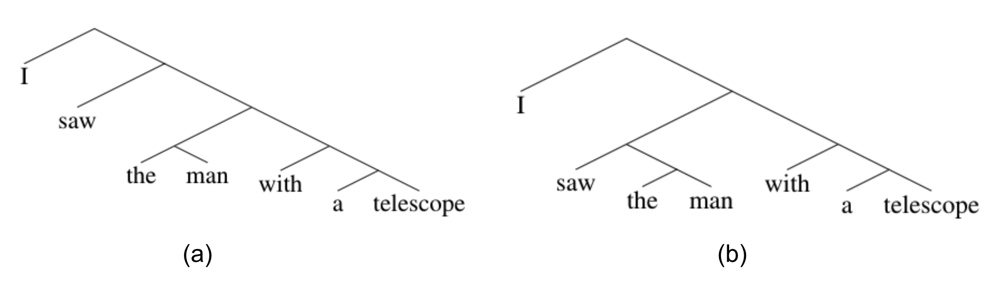
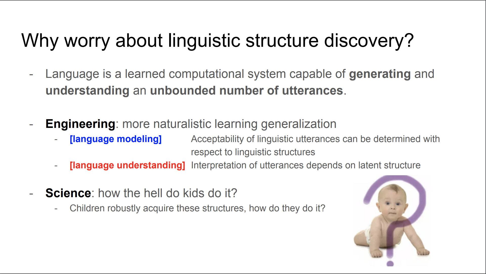

ဒီရက်ပိုင်း ကိုယ့်ကို ဘာသုတေသနလုပ်နေလဲလို့ မေးရင် သစ်ပင်တွေကိုလေ့လာနေတယ်လို့ ဟာသလုပ်ပြီး ပြန်ဖြေဖြစ်တယ်။ ကိုယ်အခု စိတ်ဝင်စားတဲ့ topic က Grammar Induction ပါ။ Grammar Inductionဆိုတာ ဘာသာစကားတစ်ခုရဲ့ syntactic structure (သဒ္ဒါဖွဲ့စည်းပုံ) ကို ကွန်ပြူတာကို အဲဒီ structure နဲ့ပတ်သတ်တဲ့ အချက်အလက်တွေမသုံးပဲ သင်ပေးတာပါ။ ပြောရရင် unsupervised learning ပေါ့။ ဒါဒီ  syntactic structure တွေအမျိုးမျိုးရှိတဲ့ အထဲကမှ constituency parse trees ရှာတာကို အဓိကထားလုပ်ပါတယ်။ Supervised parsing မှာဆို dataset မှာရှိတဲ့ စာကြောင်းတွေအားလုံးကို ဘာသာဗေဒပညာရှင်တွေ ကိုယ်တိုင် သေချာရေးထားတဲ့ gold standard parse တွေကို သုံးပြီး ဒီစာကြောင်းမှာ ဒီလိုဖွဲ့စည်းပုံရှိတယ်ဆိုပြီး ကွန်ပြူတာကို သင်ပေးတယ်။ Grammar Induction က အဲလို gold standard parse တွေဘာတွေ ဘာမှမသုံးပဲ ဒီအတိုင်း စာကြောင်းတွေကိုပဲကြည့်ပြီး သူတို့ရဲ့ သဒ္ဒါဖွဲ့စည်းပုံကို ရှာတာပါ။

Linguisticsနဲ့ မရင်းနီးသူတွေအတွက် ပထမဆုံး constituency parse tree ဆိုတာ ဘာလဲ အရင်ရှင်းပါရစေ။
ဘာသာစကားတိုင်းမှာ ဖွဲ့စည်းပုံစည်းမျဉ်းတွေရှိပါတယ်။ အလွယ်ဆုံး စာကြောင်းရဲ့နောက်ကွယ်မှာ စကားလုံးတွေရဲ့ ဖွဲ့စည်းပုံရှိတယ်။ စာတစ်ကြောင်းဟာ အဓိပ္ပာယ်ရှိတဲ့ အပိုင်းအစအသေးလေးတွေနဲ့ စုစည်းထားတာဖြစ်တယ်။ tree ရဲ့ အစိတ်အပိုင်းတွေအပေါ်မူတည်ပြီး စာကြောင်းရဲ့ အဓိပ္ပာယ်လဲ ပြောင်းလဲနိုင်တယ်။ အောက်က ဥပမာမှဆိုရင် (a) မှန်ပြောင်းကိုင်ထားတဲ့လူတစ်ယောက်ကို မြင်တာဖြစ်ပြီး (b)က လူတစ်ယောက်ကို မှန်ပြောင်းကနေ တစ်ဆင့်ကြည့်ပြီးမြင်တာဖြစ်တယ်။

  
{: .center-image} 

အဲတော့ မေးချင်တဲ့လူက မေးလိမ့်မယ်... အဲ့ parse tree က ဘာသုံးစားလို့ရလို့လဲဆိုပြီး။ ဒီမေးခွန်းကို မဖြေခင် ဇာတ်ရှိန်တက်အောင် ဇာတ်ကြောင်းပြန်ပါရစေ။
လူတွေ ကလေးဘဝ စကားစသင်တဲ့အချိန်မှာ အဲဒီဖွဲ့စည်းပုံ သဒ္ဒါတွေကို ဘယ်သူကမှ သင်ပေးစရာမလိုဘဲ ကိုယ့်ဟာကိုယ် အသင့်အတင့် သဒ္ဒါကျအောင်ပြောတတ်တယ်။ အဲဒါနဲ့ပတ်သတ်ပြီး ဘာသာဗေဒပညာရှင် Chomsky က လူတွေရဲ့ ဦးနှောက်မှာ ဘာသာစကားသင်ကြားဖို့ pre-programmedလုပ်ထားတဲ့အင်္ဂါ (language organ) တစ်ခုပါတယ်။ [^1]   အဲဒါကြောင့် လူတွေဟာ ဘာသာစကားရဲ့ ရှိသမျှ သဒ္ဒါတွေ ဖွဲ့စည်းပုံတွေကို သင်ပေးစရာမလိုဘဲ သူ့ဘာသာသူ စကားလုံးတွေစီတတ်တယ်။ အဲဒါနဲ့ပတ်သတ်ပြီး နာမည်ကြီးတဲ့ Poverty of Stimulus ဆိုတဲ့ ယူဆချက်တစ်ခု lingustics မှာရှိတယ်။ အဲဒီ Poverty of Stimulus က ဘာပြောလဲဆိုတော့ ကလေးတွေရဲ့ စကားစသင်ခါစမှာ ရှိရှိသမျှ စကားလုံးဖွဲ့စည်းပုံ သဒ္ဒါစည်းမျဉ်းတွေနဲ့ ထိတွေ့ခွင့်မရှိဘူး။ အဲဒါကြောင့် ဘာသာစကားနဲ့ သဒ္ဒါစည်းမျဉ်းတွေကို ပတ်ဝန်းကျင်က အထိအတွေ့ လှုံ့ဆော်မှူ(stimulus)ကနေ  သင်ယူတာဆိုတာ မဖြစ်နိုင်ဘူး။ သူတို့တွေ မွေးထဲက ဘာသာစကားနဲ့ပတ်သတ်တဲ့ သဒ္ဒါစည်းမျဉ်းတွေကိုသိတဲ့အင်္ဂါနဲ့ မွေးလာတာဖြစ်တယ်ပေါ့။ 

[^1]:[Noam Chomsky. 1957. Syntactic Structures.]()

သူတို့ဟာသူတို့တော့ ဟုတ်နေတာပဲ။ ကျမကတော့ အဲဒီယူဆချက်ကို လက်မခံတဲ့လူအုပ်စုထဲကပါ။ ဘယ် biologist ဘယ် neuroscientist ကမှ အဲဒီယူဆချက် မှန်ပါတယ်လို့ သိပ္ပံနည်းကျ သက်သေမပြနိုင်သေးဘူး။ အဲလို သက်သေမပြနိုင်သရွေ့ ဒါဟာ လူတစ်ချို့ရဲ့ ယူဆချက် သက်သက်ပဲ၊ မှန်တယ်လို့ အတည်ပြုလို့မရဘူး။ ဒါပေမဲ့ ဒီဟာမှားတယ်လို့ သက်သေပြနိုင်ရင် ဒီယူဆချက်ကို ပယ်လို့ရပြီ။ ဘယ်လို မှားကြောင်းပြနိုင်လဲဆိုတော့ ဘာ language organ မှမရှိတဲ့ စက်တစ်ခုက ဘာသာရပ်တွေရဲ့ သဒ္ဒါကို သူ့ဟာသူ ရှာတွေ့နိုင်ရင် လူတွေမှာပဲရှိတဲ့ special language organ ဆိုတာ အလကားယူဆချက်။ စက်တွေတောင် သူ့ဘာသာသူ ဒီစည်းမျဉ်းတွေကို supervise လုပ်ပေးစရာမလိုဘဲ သင်ယူနိုင်တယ်။ အဲဒါကြောင့် poverty of stimulus ကမှားတယ်လို့ သက်သေပြနိုင်တယ်။ အဲဒါအချက်ရယ် ကွန်ပြူတာရဲ့ ဘာသာစကားသင်ယူပုံကို ကြည့်ပြီး လူတွေရဲ့ ဘာသာစကားသင်ယူပုံကို လေ့လာနိုင်တာရယ်ကြောင့် grammar induction ကို cognitive scientist တွေနဲ့ linguist တွေက စိတ်ဝင်စားတယ်။

  
{: .center-image} 
Slide taken from Chris Dyer's talk at NAACL2019[^2]

[^2]:[Unsupervised Structure Discovery with Deep Learning. NAACL2019](http://demo.clab.cs.cmu.edu/cdyer/naacl_2019_structure_discovery.pdf)

Engineering ဘက်ကကြည့်မယ်ဆိုရင်လည်း parse tree တွေကို application တော်တော်များများမှာ အသုံးပြုနိုင်တယ်။ ဥပမာ end-to-end chatbot တွေက အခုထိ သေချာအလုပ်မလုပ်သေးတော့ relation extraction မှာ ပထမဆုံး စာကြောင်းတွေကို parse လုပ်ပြီး သက်ဆိုင်ရာ chunk တွေကို ခွဲထုတ်ရတယ်။ Information retrieval မှာ knowledge base တွေဆောက်ရင်လည်း parse tree တွေသုံးရတယ်။ 

နောက်ပေါ် NLP မှာတောင် tree-structure recursive neural net တွေသုံးပြီးဆောက်တဲ့ sentence representation တွေက sequential recurrent net တွေထက်ပိုပြီး အဓိပ္ပာယ်ပိုပါတယ်။ ဥပမာ tree-LSTM နဲ့ဆောက်ထားတဲ့ sentence representation က “I eat pizza with fork” [ (I ((eat pizza) (with fork)))] ရယ် “I eat pizza with mushroom” [ (I (eat (pizza (with mushroom)))) ] ရယ်  အဓိပ္ပာယ်မတူတာကို ခွဲခြားတတ်တယ်။ ဒါပေမဲ့ အဲလို tree information ကို supervised လုပ်ပြီး သင်ပေးဖို့ဆိုတာ ခက်တယ်။ ပထမက English တို့ German တို့လို ဘာသာရပ် အနည်းစုမှာသာ annotated corpus ခပ်ကြီးကြီးတွေရှိတယ်။ ပြောရရင် English Penn Treebank ကတောင် အဲလောက်ကြီးတာမဟုတ်။ စာကြောင်း ၅သောင်းနီးပါးပဲပါတယ်။ Deep learning algorithm တွေ ရလဒ်ကောင်းကောင်းရဖို့က စာကြောင်း သိန်းချီလောက်မှ တော်ခါကျတယ်။ Annnotate တာကလဲ တော်ရုံ mechanical turker တွေလောက်သုံးလို့မရဘူး။ Expert linguist တွေကို သုံးဖို့ကလဲ ပိုက်ဆံကသောက်သောက်လဲကုန်မယ်။ 

အဲဒါကြောင့် annotated tree တွေမသုံးဘဲ grammar ကို unsupervise methodနဲ့ ရှာဖို့ သုတေသနပညာရှင်တွေက ကြိုးစားလာကြတယ်။ အဲလိုကြိုးစားနေတာ ဆယ်စုနှစ် တစ်ခုကျော်လာခဲ့ပြီ။ ခုထိ ဘယ်သူမှ ဖြစ်ဖြစ်မြောက်မြောက် မအောင်မြင်သေးဘူး။ အဲတော့ အစောပိုင်းလူတွေက ... ကဲ စာကြောင်းအရှည်တွေမေ့ထားလိုက် စကားလုံး ၁၀လုံးလောက်ပဲ ပါတဲ့ စာကြောင်းတိုတွေ အောင်မြင်အောင် အရင်လုပ်ကွာဆိုပြီး Penn Treebank WSJ dataset ထဲက preprocessed ပြီးနောက် စကားလုံး ၁၀လုံး အောက်ပဲကျန်တဲ့ စာကြောင်းတွေစုပြီး WSJ10 လို့နာမည်တပ်၊ အဲဒီ WSJ10 ကိုပဲ focus လုပ်တော့တယ်။ အဲလိုနဲ့ စာလုံး ၁၀လုံးရဲ့ စုစည်းပုံကို ရှာတာက အဲလောက်မခက်တော့ အောင်မြင်လာပြီထင်တယ်။  WSJ10 မှာ state of the art က ၈၂% ထိရလာတယ်။ ပြီးခဲ့တဲ့နှစ်က EMNLP မှာ အဲဒီ WSJ10 သုံးထားတဲ့ model တစ်ခုကို WSJ က စာလုံး ၁၀လုံးထက်မက ပါတဲ့ စာကြောင်းတွေမှာ evaluate လုပ်ပြီး qualitative and quantative analysis လုပ်တဲ့စာတမ်းတင်ဖြစ်တယ်။ အဲဒါက ကိုယ် Grammar induction နယ်ပယ်ကို စဝင်တဲ့ စာတမ်း။  

နောက်တစ်ခုက grammar induction က လုံးဝကို unsupervise ဆိုတော့ ခက်တယ်။ အဲဒီတော့ သုတေသီတွေက ကဲ annotated parse tree မရှိဘဲ တခြား supervision signal သုံးလို့မရဘူးလားလို့ မေးခွန်းထုတ်လာကြတယ်။ သူတို့အယူအဆက တခြား supervised task တစ်ခုခုကို သင်ပေးရင်းနဲ့ tree တွေကို implicitly induce လုပ်မယ်ပေါ့။ အဲဒါကို latent tree learning method လို့ခေါ်တယ်။ ဒီ method က ပြောရရင် ၂၀၁၆ လောက်က မှ စလုပ်တာဖြစ်တဲ့ ငယ်သေးတဲ့ topic ပါ။ အစပိုင်းက Deepmind နဲ့ ဆိုးလ် အမျိုးသားတက္ကသိုလ်က အဖွဲ့ ၂ခုက classificationကို downstream task အနေနဲ့သုံးပြီး tree structure ကို သင်ဖို့ကြိုးစားခဲ့တယ်။ ဒါပေမဲ့ သူတို့၂ဖွဲ့လုံး classification performance ကောင်းကောင်းရပေမဲ့ linguistic rule တွေနဲ့ကိုက်တဲ့ tree တွေကို မသင်ယူနိုင်ခဲ့ဘူး။ အဲဒီ classification-based latent tree တွေကို analyze လုပ်တဲ့စာတမ်းမှာ ဒီtreeတွေက random ဆွဲထားတဲ့ tree တွေလောက်တောင် Penn Treebank grammar နဲ့ မကိုက်လို့ ဘာlinguistic property မှမရှိဘူးလို့ ဝေဖန်ခံရခဲ့တယ်။[^3] ဒါပေမဲ့ ပြီးခဲ့တဲ့နှစ်က MILA ကအဖွဲ့နဲ့ UMass Amherst ကအဖွဲ့က language model ကိုသုံးပြီး Penn Treebank grammar နဲ့ ၄၀%နဲ့အထက် ကိုက်ညီတဲ့ latent tree တွေသင်နိုင်ခဲ့တယ်။ [^4],[^5],[^6] Grammar induction ၄၀%ကျော်ဆိုတာက state-of-the-art ဖြစ်ပေမဲ့ ၉၀%ကျော်လောက်ရတဲ့ supervised parser ကိုမှီဖို့ အများကြီးကြိုးစားရဦးမယ်။ ၂၀၁၉ထဲမှာတော့ ဒီtopicကနည်းနည်းပိုပြီး စိတ်ဝင်စားလူတွေပိုများလာတယ်။ ဟားဗတ်နဲ့ DeepMind နဲ့လဲပေါင်းပြီး NAACLမှာ Unsupervised Recurrent Neural Network Grammars ဆိုတဲ့ ပေပါထုတ်ဖြစ်တယ်။ တခြား အဖွဲ့တွေက ထုတ်တဲ့ Grammar induction ပေပါတွေလည်း NAACL မှာအရင်ကထက်ပိုလာတာကို တွေ့ရတယ် (အရင်က ကိုယ်တွေပဲရှိတာလေ)။ MILA က Ordered Neuron ဆိုတဲ့စာတမ်းကလဲ ICLR မှာ best paper award ရသွားတယ်။[^5] DeepMindက Chris Dyerကလည်း NAACL မှာ Grammar induction နဲ့ပတ်သတ်တဲ့ [talk](http://demo.clab.cs.cmu.edu/cdyer/naacl_2019_structure_discovery.pdf) ပြောသွားတယ်။

[^2]:[Unsupervised Structure Discovery with Deep Learning. NAACL2019](http://demo.clab.cs.cmu.edu/cdyer/naacl_2019_structure_discovery.pdf)
[^3]:[Do latent tree learning models identify meaningful structure in sentences?](https://arxiv.org/abs/1709.01121)
[^4]:[Neural Language Modeling by Jointly Learning Syntax and Lexicon](https://arxiv.org/abs/1711.02013)
[^5]:[Ordered Neurons: Integrating Tree Structures into Recurrent Neural Networks](https://arxiv.org/abs/1810.09536)
[^6]:[Unsupervised Recurrent Neural Network Grammars](https://arxiv.org/abs/1904.03746)

ကိုယ်လည်း ဒီ latent tree နဲ့ပတ်သတ်တာကို ပြီးခဲ့တဲ့ ၈လ လောက်က လုပ်နေပေမဲ့ စာတမ်းကို conference တစ်ခုမှာ လက်ခံတာမခံရသေးခင် အဲဒီ project ကိုထုတ်ပြောလို့မရသေးဘူး။ ဒါပေမဲ့ ဒီနှစ် နိုဝင်ဘာလောက်တော့ ပေပါကို ထုတ်ပေးနိုင်ဖို့မျှော်လင့်ပါတယ်။ :) 

ဒီပို့စ်ကို ဖတ်ပြီး ကိုယ့်တွေဘာလုပ်နေလဲဆိုတာ နည်းနည်းပါးပါး နားလည်လာမယ်လို့ မျှော်လင့်ပါတယ်။ :)

  
# References
---
