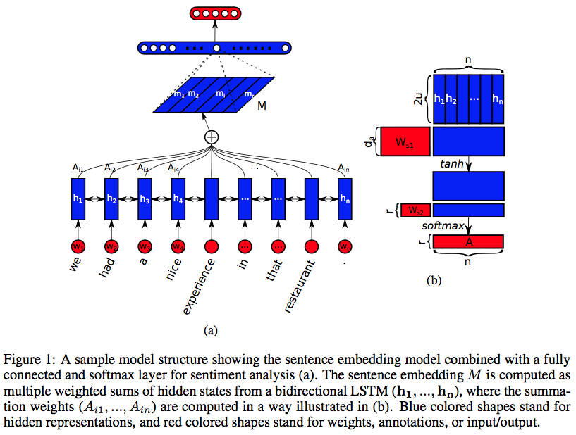

Paper: **Structured Self-attentive sentence embedding** [arxiv](https://arxiv.org/abs/1703.03130)

The authors propose:
- a new embedding which uses 2-D matrix for embedding, each row of the matrix attending to different part of the sentence.
- Self-attention mechanism and special regularisation term for the model

## **Model**
---
Two parts:
1. Bidirectional LSTM
2. Self-attention Mechanism

The **self attention mechanism** provides a set of summation vectors that are dotted with LSTM hidden states.
The resulting weighted LSTM hidden states are considered as embedding.

Figure 1 (a) is an example of proposed model combined with Fully-connected and softmax layer for the sentiment analysis task.  

  

Sentence embedding S = \\( (w_1 , w_2, …., w_n) \\)  is a 2D matrix with `nxd` dimension, which concatenates all the word vectors together.

- `u` = *the number of hidden units for each unidirectional LSTM*.
- `H` =  \\( (h_1 , h_2, …., h_n) \\)  that has `n x 2u`dimension.

$$ \mathbf{a} = \mathbf{W}\_{s2} $$

