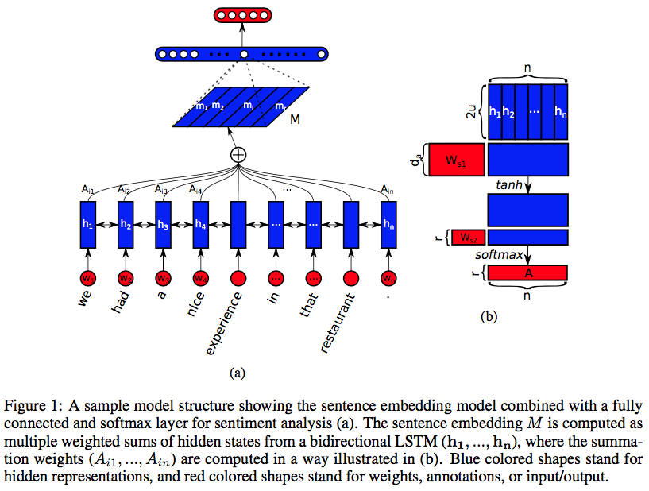

The authors propose:
- a new embedding which uses 2-D matrix for embedding, each row of the matrix attending to different part of the sentence.
- Self-attention mechanism and special regularisation term for the model

**Question: Is it necessary to carry the semantic along all time-steps of a recurrent model?**
- Propose a self-attention to replace the max pooling or averaging step.
Self-attention allows extracting different aspects of sentence into multiple vector representations.

## Model
Two parts:
1. Bidirectional LSTM
2. Self-attention Mechanism

The **self attention mechanism** provides a set of summation vectors that are dotted with LSTM hidden states.
The resulting weighted LSTM hidden states are considered as embedding.

Figure 1 (a) is an example of proposed model combined with Fully-connected and softmax layer for the sentiment analysis task.  

  

Sentence : S = \\( (w_1 , w_2, …., w_n) \\) 

\\(\mathbf{y}\_{3}\\) 